<a href="https://www.nielsvandervelden.com/">
<picture>
  <source media="(prefers-color-scheme: dark)" srcset="assets/banner-dark-v3.svg" />
  
</picture>
</a>

I turn messy biological data into analysis pipelines, Shiny apps, reports and dashboards that people actually use. PhD from ETH Zürich, five years in biotech at Molecular Partners, now consulting independently.

---

## What I Do

- **Data Science**: end-to-end workflows from raw data to clean analysis, models and reports, mostly in R and Python, with a focus on reproducibility
- **Shiny & Web Apps**: interactive dashboards and tools, including apps that run entirely in the browser with Shinylive and WebAssembly
- **Bioinformatics & Mass Spectrometry**: gene cluster visualization, protein structure viewers and peptide identification tooling

---

## Featured Projects

**[geneviewer](https://github.com/nvelden/geneviewer)** &nbsp;·&nbsp; `R` `Python` `JavaScript` `D3`

Publication-ready gene cluster maps from GenBank, FASTA and GFF files, with alignment results drawn on gene arrow maps. One D3 rendering core ([geneviewer-js](https://github.com/nvelden/geneviewer-js)) shared by the R and [Python](https://github.com/nvelden/geneviewer-py) packages. [Docs](https://nvelden.github.io/geneviewer-docs/)

 

**[NGLVieweR](https://github.com/nvelden/NGLVieweR)** &nbsp;·&nbsp; `R` `Shiny` `WebGL`

Interactive 3D protein structure viewer for R and Shiny, built on NGL. Comes with a [Shiny UI](https://github.com/nvelden/shinyNGLVieweR) and a [browser-only Shinylive version](https://nvelden.github.io/shinyliveNGLVieweR/).

 

**[shinyblocks](https://github.com/nvelden/shinyblocks)** &nbsp;·&nbsp; `R` `Shiny` `WebAssembly`

Composable modern UI blocks for Shiny dashboards, inspired by shadcn/ui. Built on [r-universe](https://github.com/nvelden/nvelden.r-universe.dev), including WebAssembly binaries.

---

## Tech Stack

  

**Data & Science**

---

## Origin Story

I'm a mycologist at heart. My PhD at ETH Zürich was about *Omphalotus olearius*, a mushroom whose enzyme OphA methylates its own backbone to make omphalotin, a cyclic peptide that kills nematodes ([Nature Chemical Biology, 2017](https://www.nature.com/articles/nchembio.2393)).

After my PhD I spent five years at [Molecular Partners](https://www.molecularpartners.com/), a Swiss biotech, as an Expert Scientist in mass spectrometry. I coordinated every project there that involved mass spectrometry and developed an automated data analysis platform for our measurements. Many of the apps and tools I've built on the side relate to that work. These days I consult independently and build tools that turn raw lab data into something people can read and use.

---

*Currently consulting independently* &nbsp;·&nbsp; [Website](https://www.nielsvandervelden.com/) &nbsp;·&nbsp; [LinkedIn](https://www.linkedin.com/in/nielsva) &nbsp;·&nbsp; [Publications](https://www.nielsvandervelden.com/publications)
