<a href="https://www.nielsvandervelden.com/">
<picture>
  <source media="(prefers-color-scheme: dark)" srcset="assets/banner-dark-v6.svg" />
  
</picture>
</a>

## What I Do

- **Data Science**: end-to-end workflows from raw data to clean analysis, models and reports, mostly in R and Python, with a focus on reproducibility
- **Shiny & Web Apps**: interactive dashboards and tools, including apps that run entirely in the browser with Shinylive and WebAssembly
- **Bioinformatics & Mass Spectrometry**: gene cluster visualization, protein structure viewers and peptide identification tooling

---

## Featured Projects

**[geneviewer](https://github.com/nvelden/geneviewer)** &nbsp;·&nbsp; `R` `Python` `JavaScript` `D3`

Publication-ready gene cluster maps from GenBank, FASTA and GFF files, with alignment results drawn on gene arrow maps. One D3 rendering core ([geneviewer-js](https://github.com/nvelden/geneviewer-js)) shared by the R and [Python](https://github.com/nvelden/geneviewer-py) packages. [Docs](https://nvelden.github.io/geneviewer-docs/)

 

**[NGLVieweR](https://github.com/nvelden/NGLVieweR)** &nbsp;·&nbsp; `R` `Shiny` `WebGL`

Interactive 3D protein structure viewer for R and Shiny, built on NGL. Comes with a [Shiny UI](https://github.com/nvelden/shinyNGLVieweR) and a [browser-only Shinylive version](https://nvelden.github.io/shinyliveNGLVieweR/).

 

**[shinyblocks](https://github.com/nvelden/shinyblocks)** &nbsp;·&nbsp; `R` `Shiny` `WebAssembly`

Composable modern UI blocks for Shiny dashboards, inspired by shadcn/ui. Built on [r-universe](https://github.com/nvelden/nvelden.r-universe.dev), including WebAssembly binaries.

---

## Tech Stack

  

**Data & Science**

---

## Origin Story

I started out in the lab. For my PhD at ETH Zürich I studied *Omphalotus olearius*, the jack-o'-lantern mushroom, and worked out how its enzyme OphA methylates its own backbone to make omphalotin, a cyclic peptide that kills nematodes ([Nature Chemical Biology, 2017](https://www.nature.com/articles/nchembio.2393)).

From there I moved to [Molecular Partners](https://www.molecularpartners.com/), a Swiss biotech, where I spent five years as an Expert Scientist in mass spectrometry. I coordinated all of our mass spectrometry projects and built an automated platform to analyse the data, and much of what I've built on the side is related to that work.

Now I consult independently, turning raw lab data into analyses, apps and reports that people can use.

---

## Work With Me

I'm available for consulting and freelance projects: mass spectrometry data analysis, R/Shiny and Python apps, automated reporting and data pipelines. Open to collaborations too.

